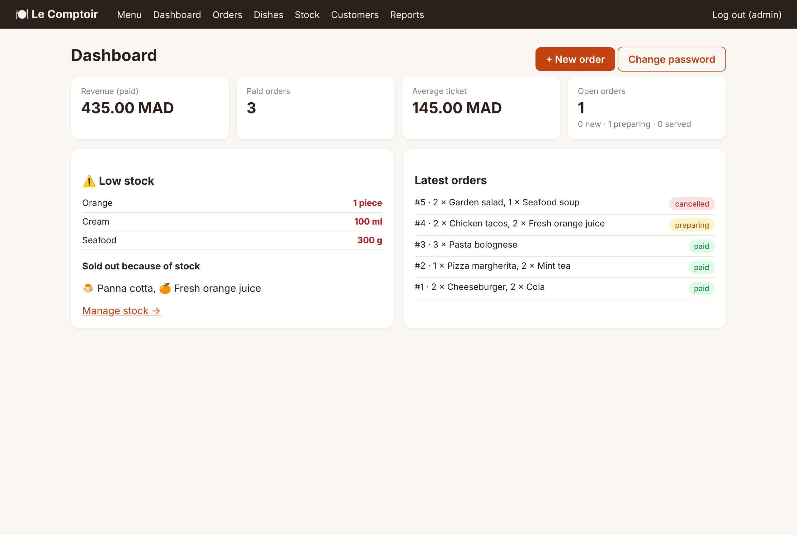
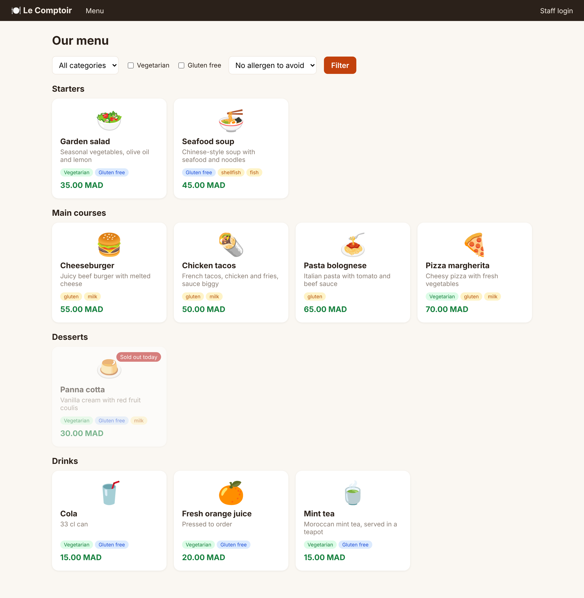
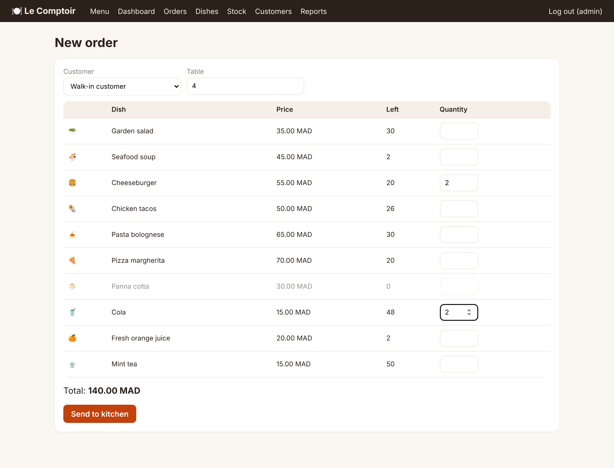

# Restaurant Management System

[](https://github.com/Haytamzerr/restaurant-management-system/actions/workflows/tests.yml)

A web app to run a small restaurant: a public **menu** with allergens and dietary filters, and a staff side for **orders**, **stock**, **customers** and **sales reports**. Stock is linked to recipes, so selling a dish takes its ingredients out of stock, and a dish shows as *sold out* by itself when an ingredient runs short.

Built with **Python · Flask · SQLite · HTML/CSS**. No JavaScript framework, and no database server to install.



| Public menu | Taking an order |
|---|---|
|  |  |

## Features

**For customers**
- Menu by category, with a price, description, tags (vegetarian, gluten free) and allergens for every dish
- Filters: category, vegetarian, gluten free, "without" an allergen (milk, gluten, fish…)
- Dishes that can't be made with the current stock show as **sold out** automatically

**For staff** (login required)
- **Orders**: take an order (table, customer, several dishes, live total), then move it through `new → preparing → served → paid`, or cancel it
- **Stock**: ingredients with units and alert levels; record deliveries or correct after an inventory; low-stock warnings on the dashboard
- **Recipes**: the quantity of each ingredient one portion uses, which gives the number of portions left for every dish
- **Dishes**: create, edit, hide or delete; a dish already in past orders is hidden instead of deleted, so old bills stay valid
- **Customers**: contact details, number of orders, total spent
- **Reports**: revenue, average ticket, best sellers, sales by day
- **CSV export** of orders, stock and menu (opens in Excel)

## Design decisions

| Problem | What the app does |
|---|---|
| Floating-point money: `0.1 + 0.2 ≠ 0.3` | Prices are stored as **integer cents** and formatted only for display |
| Two waiters selling the last portion at the same time | Orders run in one **transaction** (`BEGIN IMMEDIATE`): stock is checked and decremented under a lock |
| A burger and a bolognese share the same beef | Ingredient needs are **added up across the whole order** before checking stock |
| A dish runs out halfway through an order | **All or nothing**: if one line fails, nothing leaves the stock and no order is created |
| Changing a price must not change old bills | The price is **copied into each order line** at the time of sale |
| Revenue that wasn't collected | Reports count **paid** orders only |
| A cancelled order | Its ingredients **go back into stock** |
| An order jumping from *new* to *paid* | A **state machine** allows only the next valid status |
| Security | Hashed passwords (scrypt), CSRF token on every form, new session on login, parameterised SQL everywhere (no injection) |

### Data model

```
categories ─┐
            ▼
          dishes ──< recipe >── ingredients
            │
            ▼
customers ─< orders ─< order_items
```

## Run it

You need Python 3.10+.

```bash
git clone https://github.com/Haytamzerr/restaurant-management-system.git
cd restaurant-management-system
python -m venv .venv
# Windows: .venv\Scripts\activate    macOS/Linux: source .venv/bin/activate
pip install -r requirements.txt
python run.py
```

Open <http://localhost:5000>. The database is created on first run with a demo menu, stock and customers.
**Staff login: `admin` / `admin`**. Change it on the dashboard.

To reset the database (or start with an empty one):
```bash
flask --app app init-db            # demo data
flask --app app init-db --empty    # empty restaurant
```

Before deploying anywhere public, set a real secret key: `SECRET_KEY=<long random string>`.

## Tests

```bash
pip install pytest
pytest
```

20 tests cover the rules above: stock taken on sale, all-or-nothing orders, shared ingredients, sold-out dishes, the status flow, stock restored on cancellation, old bills keeping their price, paid-only revenue, login, CSRF, filters, dish creation and CSV export. They run on every push with GitHub Actions.

## Project structure

```
app/
  __init__.py     app factory, CSRF, first-run database
  schema.sql      tables and constraints
  db.py           connection, demo data, `init-db` command
  services.py     business rules (menu, stock, orders, reports), no Flask inside
  auth.py         staff login, password change
  public.py       welcome page and menu
  staff.py        dashboard, orders, dishes, stock, customers, reports, CSV
  templates/      Jinja pages
  static/         stylesheet
tests/            pytest suite
run.py            start the app
```

## Authors

- **Haytam Zerrouki**
- **Hamza Bouafi**

Started as a university project (Flask + MySQL), supervised by **Mr. Zakaria El Alami**, then extended into this version: SQLite, recipes linked to stock, the order workflow, reports, security and tests.

## Ideas for next steps
- A kitchen screen that refreshes by itself with the orders to prepare
- Customers ordering from a QR code on their table
- Several staff roles (waiter, cook, manager)
- Dish photos
